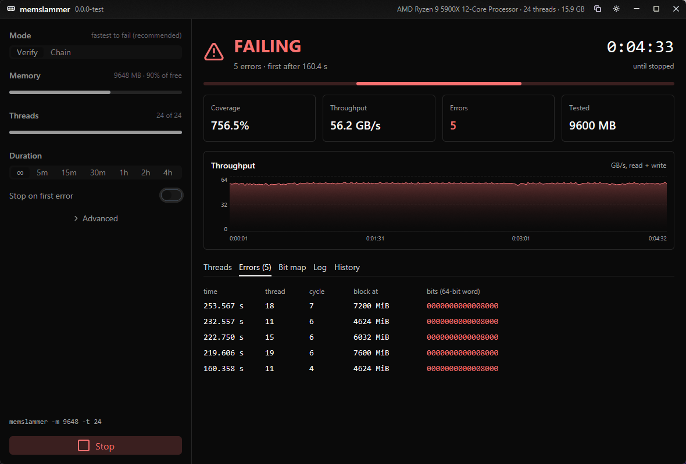
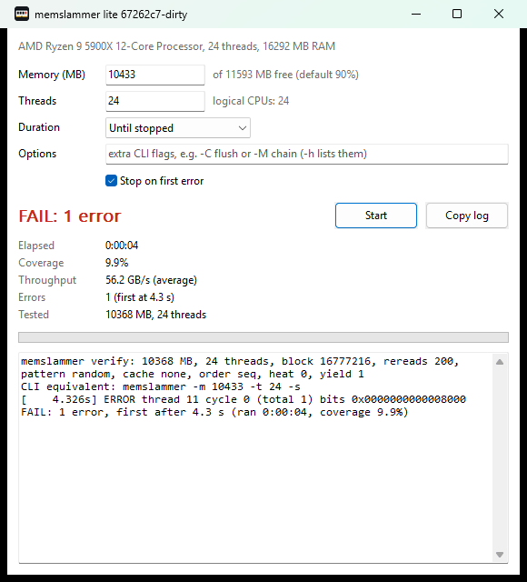
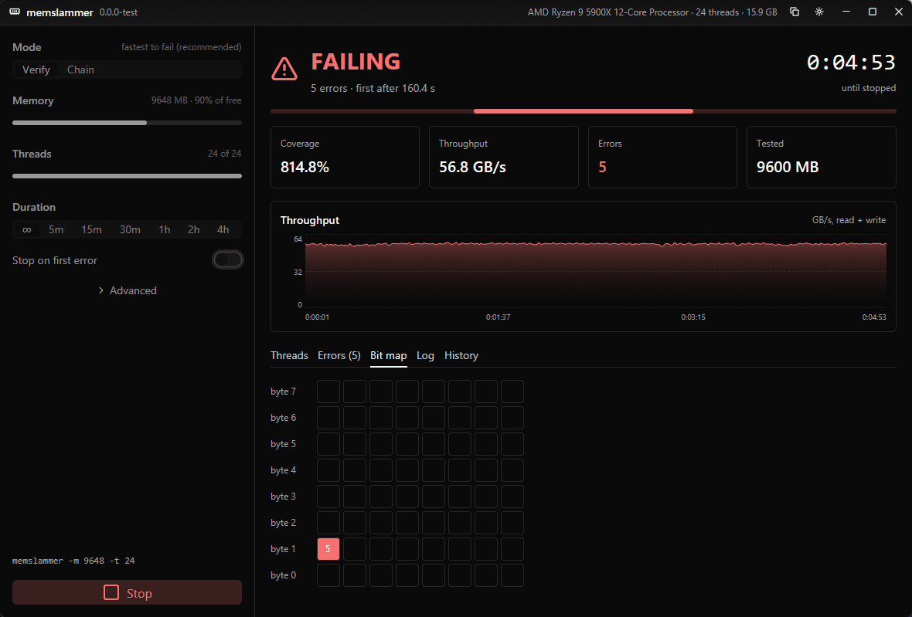

# memslammer

A memory stress test for **DDR overclock validation**, built to do one thing:
make an unstable memory overclock fail **as fast as possible**.



**[Download](https://github.com/Francesco149/memslammer/releases/latest)** ·
**[Website](https://francesco149.github.io/memslammer/)** ·
[raw results](docs/results.md)

- **Fastest from cold** on our DDR4 test box: median 218 s to the first
  error, against 368 s for Karhu RAM Test and 418 s for TestMem5 anta777
  Absolut. It won all 3 rounds of the race.
- **Since 0.2.0 the default fails 2–3x sooner still** (20 re-reads per fill
  instead of 200): 112 s against 216 s on a DDR4 fault, 40 s against 118 s
  on a DDR5 one. See [Measurements](#measurements).
- **Three frontends, one engine**: a CLI, a tiny native window, and a full
  GPU-rendered app. All of them link the same C core.
- **Small and boring to run**: single static binaries, no installer, driver,
  admin rights, network or telemetry. The Windows CLI + GUI zip is ~150 KB.
- **Needs** x86-64 with AVX2 (Haswell, Zen or newer); Windows 10/11 or any
  Linux.

## Downloads

Each release has two archives per OS:

| archive | contents | size |
|---|---|---|
| `memslammer-VER-windows-x64.zip` | `memslammer.exe` (CLI) + `memslammer-lite.exe` (Win32 window) | ~150 KB |
| `memslammer-VER-linux-x64.tar.xz` | `memslammer` (static musl CLI) + `memslammer-lite` (GTK 3 window) | ~50 KB |
| `memslammer-gui-VER-windows-x64.zip` | `memslammer-gui.exe`, the full app | ~6 MB |
| `memslammer-gui-VER-linux-x64.tar.xz` | `memslammer-gui` (needs Vulkan or GL) | ~9 MB |

The full app is a separate download, so the minimal package stays tiny.
`SHA256SUMS.txt` lists checksums. The binaries are built by
[GitHub Actions](.github/workflows/release.yml) from the tagged commit.

## Using it

- Close other programs and start a test. The default is `verify` mode on 90%
  of free RAM, all threads, 20 re-reads per fill, until stopped. That's the
  configuration that failed fastest across both of our test faults.
- **Any error means the memory overclock is unstable.** The GUIs stop at the
  first error by default.
- Errors come faster once the DIMMs are warm. The same DDR4 setting failed
  in 5–45 s on a hot box and took 1.5–3 min from cold. The real tuning loop
  (change one timing in UEFI, boot, retest) is a cold start, so that's what
  memslammer is tuned for.
- If the default passes, try `-r 2` next (2 re-reads per fill; "Re-reads
  per fill" in the full app's advanced settings). It writes four times as
  often: it found a DDR5 fault that corrupts stored data in 7.5 s against
  40 s for the default, and was no faster than the old default on a DDR4
  fault that only breaks reads.
- A clean run is evidence, not proof. We tuned on two machines and two
  kinds of fault ([Measurements](#measurements)). Use memslammer to reject
  bad settings quickly, and validate your final settings longer.

### Frontends

| | what | Windows | Linux |
|---|---|---:|---:|
| `memslammer` | CLI; scriptable, works over SSH and from live USBs | 99 KB | 84 KB |
| `memslammer-lite` | plain Win32 controls / GTK 3; DPI-aware, keeps the PC awake | 152 KB | 60 KB |
| `memslammer-gui` | [GPUI + gpui-kit](https://gpui-kit.com/): live throughput chart, per-thread coverage, error list, failing-bit map, run history, copyable report | 14 MB | 32 MB |

<p>


</p>

### CLI

```
memslammer [options]          # no options: verify 90% of free RAM until stopped
  -m MB  -t THREADS  -d SECONDS  -s (stop on first error)  -M verify|chain
  -h lists every option: block size, re-reads, pattern, cache policy, ...
```

Real output from the DDR4 test box (Linux live USB, warm, unstable setting):

```
$ memslammer -s
memslammer verify: 13440 MB, 24 threads, block 16777216, rereads 20, pattern random, cache none, order seq, heat 0, yield 1, late 1, fill store
[     10.1s] cycles 24, coverage 167.1%, 50.38 GB/s, errors 0
[     20.1s] cycles 72, coverage 331.4%, 50.70 GB/s, errors 0
[     30.1s] cycles 102, coverage 494.9%, 50.76 GB/s, errors 0
[   31.415s] ERROR thread 20 cycle 5 (total 1) bits 0x0000000000008000 pass 7 recheck 0/2
[     31.5s] cycles 116, coverage 516.2%, 49.61 GB/s, errors 1
RESULT tester=memslammer errors=1 first_error_s=31.415 elapsed_s=31.452
```

- `bits` marks the bit positions of a 64-bit word that flipped.
- `pass` is which re-read caught it; `late` is the check just before the
  block's next fill.
- `recheck 0/2` means two more reads of the same data came back right: the
  read was bad, the stored data fine. `2/2` means the data in DRAM is wrong.

Exit status: 0 no errors, 1 errors, 2 bad arguments. Ctrl+C stops cleanly.
The GUIs show the equivalent CLI command for their settings.

## How it works

`verify`: each thread walks its share of memory in 16 MiB blocks. It fills
a block with random data (xoshiro256\*\*, fresh seed per block), then
re-reads and compares it 20 times. The expected values are regenerated on
the fly, so there's no second copy to read. Any mismatch is an error.
A cycle later, just before the block is filled again, it's compared once
more: by then the data has sat in DRAM unread while the rest of the memory
was being tested, which is what shows a refresh or retention problem.

What mattered, from [docs/results.md](docs/results.md):

- **Random data.** The same loop with low-entropy patterns never failed.
- **A working set far bigger than L3.** With small blocks or half the
  threads, the re-reads stayed in cache and nothing failed in 15 minutes.
- **20 re-reads per fill, not 200.** We started from TM5's 200. With 20,
  more of the time goes to writing fresh data, and both test faults fail
  2–3x sooner.
- **The late check.** On the DDR5 fault it found 7–46% of the errors in
  every run; before it, those blocks were overwritten unchecked.
- **Not** cache flushing, non-temporal prefetch or an FP heat burst. A
  non-temporal fill (`-N`) found a tenth of the errors per fill on the DDR5
  fault. Shuffled re-read order (`-A shuffle`) did nothing on DDR4 and
  raised the DDR5 error rate 2.5x at 70% of the bandwidth. All stay
  available as options for testing on other hardware.
- Starting temperature outweighs every knob we tuned, so every comparison
  interleaves contenders.

`chain` is a clean-room reimplementation of the technique Karhu RAM Test
uses ([docs/karhu.md](docs/karhu.md)), kept as a baseline. `verify` is
modelled on test 1 of TM5's Absolut profile ([docs/tm5.md](docs/tm5.md)).

## Measurements

Every number is the time to the first error from a cold start, on a
setting made unstable on purpose. Two machines, each with one kind of
timing set too low and everything else stable. Raw data and every batch:
[docs/results.md](docs/results.md).

### The two test scenarios

| | DDR4: reads go wrong | DDR5: stored data goes wrong |
|---|---|---|
| Machine | Ryzen 9 5900X, 2x8 GB DDR4 at 3600 MT/s | Ryzen 7 7800X3D, 2x16 GB DDR5 (SK hynix M-die) at 6000 MT/s, EXPO profile |
| What's set too low | **tCL 14 / tRCD 14**: the delays before data comes out of a row | **tRTP 16** (EXPO sets 23): the delay between a read and closing its row |
| What an error looks like | One read returns a wrong bit; reading the same data again returns it right. Nearly always the same data line (byte 1, bit 7). | The data in DRAM has changed: every re-read returns the same wrong bits. Nearly always the same byte lane, 2–3 bits at a time. |
| What brings it out | Reading random data. Low-entropy patterns never failed. | Writing. Errors scale with how often the memory is filled; re-reading in shuffled order adds more. |
| Temperature | Seconds to fail when hot, minutes from cold. | Follows DIMM temperature closely: the error rate rises 5–7x between 40 and 45 °C. |
| Side effects | None. No WHEA or machine-check events; only a tester sees it. | Left running hot for 10 minutes it corrupts the operating system too (kernel bad-page reports, broken system tools). |
| A cold start is | 5 minutes idle before each run, about what a trip through UEFI takes. | Both DIMMs back to about idle temperature (36 °C by their own sensors), then 1 minute idle. |
| Runs on | Windows, and Linux from our live USB | Linux from our live USB |

Within a comparison the contenders take turns and the order rotates every
round, because the same configuration moves 2–3x with the time of day and
how long the box has been on.

### Re-reads per fill: why the default is now 20

`verify` fills a block once, then re-reads it N times. N was 200 until
0.2.0. Median seconds to the first error from cold:

| scenario | 20 (default) | 2 (`-r 2`) | 200 (old default) |
|---|---:|---:|---:|
| DDR4, bad reads, 4 rounds | **112** | 194 | 216 |
| DDR5, stored data corrupted, 4–5 runs each | **40** | 7.5 | 118 |

- **20 beat 200 on both faults.** On DDR4 it won all four rounds (97, 113,
  111, 181 s against 209, 222, 160, 236 s). On DDR5 every run of 20
  (15–48 s over two days) beat every run of 200 (96–139 s, the day before,
  DIMMs about 1 °C cooler at the start).
- **2 re-reads are far faster when writes are the problem, and no better
  than 200 when reads are.** DDR5: 4–21 s over 5 runs. DDR4: 211, 68, 176,
  230 s. So 20 is the default, and `-r 2` is the second thing to try.

### Against Karhu and TM5

DDR4 scenario, 15 min idle before each run, 3 rounds, order rotated.
Median seconds to the first error:

| tester | round 1 | round 2 | round 3 | median |
|---|---:|---:|---:|---:|
| **memslammer `verify`** | 394 | 218 | 114 | **218** |
| Karhu RAM Test | 568 | 368 | 320 | 368 |
| memslammer `chain` | 682 | 411 | 160 | 411 |
| TestMem5 anta777 Absolut | 443 | 418 | 319 | 418 |

This race ran with the default of the time, 200 re-reads. Karhu and TM5
have not been raced against the new default, or on the DDR5 box: they are
Windows programs and that box ran the Linux live USB.

Limits: two machines, both AMD, two fault types, small samples. Differences
under ~1.5x in median are noise at these sample sizes. We found no tRFC
setting that fails quickly, so refresh-timing faults are untested.

## Status

- [x] Karhu RAM Test algorithm documented: [docs/karhu.md](docs/karhu.md)
- [x] TestMem5 MT0 test functions and the Absolut profile documented: [docs/tm5.md](docs/tm5.md)
- [x] Benchmark harness (Karhu, TM5, memslammer; crash/reboot aware)
- [x] `verify` mode, fastest from cold (median 218 s vs Karhu 368 s, TM5 418 s)
- [x] Linux: fails as fast as on Windows (median 211 s, 4/4)
- [x] DDR5 (7800X3D): a tRTP fault found in 40 s; late check; `-r 20` the default (2–3x sooner on both test faults)
- [x] Core library + CLI, lite (Win32/GTK) and full (gpui) frontends; CI releases
- [ ] Test on more machines and fault types (refresh timings, Intel); race Karhu and TM5 against the new default

## Building

```
make                  # CLI + lite for Linux and Windows: gcc, mingw-w64, GTK 3 headers
                      # (musl-gcc, if installed, makes the Linux CLI static musl)
make gui              # full app for this OS: Rust stable (Linux: Vulkan/X11/Wayland headers)
make test             # self-test: injects bit flips while the test runs, checks they're caught
make dist             # release archives in dist/
make live             # live USB ISO for testing other machines (live/README.md)
```

Layout:

```
core/       the engine: memslammer.h (API), memslammer.c (portable control),
            engine.c (the AVX2 test loops, the only file built with -mavx2)
cli/        command line
lite/       Win32 and GTK 3 windows, sharing lite/common.c
gui/        Rust app: FFI to the core (build.rs compiles it in) + gpui-kit UI
res/        icon, Windows manifest and version resources
tests/      core self-test
harness/    benchmark rig (runs testers on a remote box, records time-to-first-error)
docs/       how Karhu and TM5 stress memory, and every benchmark result
site/       GitHub Pages
live/       recipe for a live USB that runs memslammer and the harness on other machines
```

The core API is poll-based: `ms_start(config)` returns at once,
`ms_get_status`/`ms_get_errors` can be called from any thread, and
`ms_free` stops and cleans up. Frontends never touch the test loops.

## Releasing

```
make release V=0.2.0
```

This tags `v0.2.0` and pushes it. [release.yml](.github/workflows/release.yml)
then builds the CLI and lite binaries (Ubuntu 22.04: musl, mingw-w64,
GTK 3) and the full app on Linux and Windows. It runs the self-test, packages
the four archives with checksums and third-party license notices, and
publishes the GitHub release. A version with a hyphen (`0.2.0-rc1`)
becomes a prerelease. [pages.yml](.github/workflows/pages.yml) publishes
`site/` (one-time setup: Settings > Pages > Source: GitHub Actions).

## Benchmark harness

Runs testers on a remote Windows or Linux machine over ssh (`MSBENCH_HOST`,
default `cutestation-win`), stops each at its first error, and appends a
record to `results/runs.jsonl`. Each record holds the outcome (`pass`, `error`,
`reboot`, `harness_lost`, `host_down`), the time to first error, and any
WHEA, Kernel-Power 41, or bugcheck events logged during the run.

```
harness/bench.py deploy --tm5 /path/to/TestMem5     # TM5 v0.13.1 folder; not redistributed here
harness/bench.py run karhu --label "3800 trfc 250" --seconds 1800 --repeat 3
harness/bench.py run tm5 --label "3800 trfc 250"            # Absolut @ anta777 by default
harness/bench.py run "tm5:Extreme @ anta777" --label ...
harness/bench.py run memslammer --label ... -- -M chain     # extra args after --
harness/bench.py run memslammer --warmup 600 --rate --seconds 120 -- -C flush
harness/bench.py timings                                    # what the IMC is running now
harness/bench.py summary
```

- Every run logs the DRAM timings the memory controller is actually running
  (decoded, plus the raw UMC registers). Without `--label`, the label is
  built from them (`3600 c14 rcd14 rp16 ras36 rfc324`), so you can't forget to
  record a setting. The timings reader (`harness/memtimings.c`) is a harness
  tool and isn't shipped in releases.
- memslammer runs record their mode: without `-M`, the harness passes
  `-M verify` (the default since the frontends split). Older records with no
  `-M` were `chain` runs.
- `--warmup S` runs memslammer `chain` for S seconds first, unrecorded.
  DRAM temperature changes time-to-error by up to ~10x, so compare runs
  started at the same temperature.
- `--idle S` sleeps S seconds before the run so the DIMMs start cold. `--idle 300`
  approximates the real loop (about 5 min in UEFI, then retest). This is
  the metric that matters for real tuning: time to first error from cold.
  CPU Tctl is logged at the start and end of each run, but it follows CPU
  boost, not DRAM temperature.
- `--rate` keeps going past the first error and records every error time and
  errors/min. That gives more signal per run than first-error time once
  everything fails in seconds. Not supported for TM5 (it logs one error per
  test block). Error units differ between testers, so compare rates only
  within one tester/mode.
- Karhu is driven headlessly through `harness/karhu_drv.c`, which loads your
  own licensed `ramtest.dll` (`MSBENCH_KARHU_DLL`).
- Karhu and memslammer test 90% of free RAM unless you pass `--mb`. TM5 sizes
  itself.
- Timings need [PawnIO](https://pawnio.eu) on the target
  (`winget install namazso.PawnIO`). `deploy` fetches its signed
  `AMDFamily17` module (LGPL, not stored in this repo). AMD Zen 2/3 with DDR4
  is decoded so far.
- A run refuses to start if another tester is already running on the target.

### Linux targets

```
export MSBENCH_OS=linux MSBENCH_HOST=cutestation-linux
harness/bench.py deploy                                     # to /root/msbench
harness/bench.py run memslammer --idle 300
```

- Log in as root: reading the timings writes the SMN index register in PCI
  config space (sysfs), and that needs root and no kernel lockdown.
- memslammer only. Karhu and TM5 are Windows programs.
- Free RAM is `MemAvailable`, which includes reclaimable page cache.
  Hardware events come from the kernel log: `mce` counts machine-check, EDAC
  and memory-failure messages (WHEA's role on Windows), and `oops` counts
  kernel oopses and segfaults.
- Records carry `"os": "linux"`, and `summary` lists them separately.
- DDR5 DIMMs have a temperature sensor (`spd5118` driver), and on DDR5 the
  error rate follows it closely. `--gate-dimm 35` waits until every DIMM
  reads 35 °C or less before the run (then `--idle`), so runs start equally
  cold however hot the last one left them. `--sample` logs Tctl, the DIMM
  temperatures and the CPU clock once a second to
  `results/samples/<run id>.tsv`, streamed off the box so a crash doesn't
  lose it. Records carry `dimm_start_c` and `dimm_end_c`.

### Live USB

[live/](live/README.md) builds a bootable Arch Linux ISO for testing other
machines without touching their disks or settings. It boots from Ventoy or a
dd'd stick (UEFI or BIOS), brings up Ethernet and Wi-Fi on its own, answers
as `memslammer.local`, and accepts your ssh key. `/root/msbench` comes
pre-populated, so `MSBENCH_OS=linux MSBENCH_HOST=ms-live harness/bench.py run
memslammer` works right after boot. The ISO carries your Wi-Fi passphrase
and an ssh host key, so we publish the recipe, not the image.

## License

MIT. This repository contains no code or binaries from the tools studied.
The full app bundles open-source Rust crates (GPUI, gpui-kit, Lucide icons
and their dependencies); their notices ship in `THIRD-PARTY-LICENSES.txt`.
